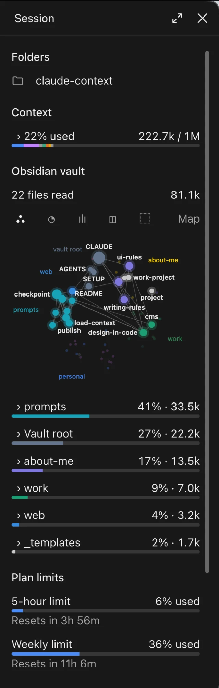
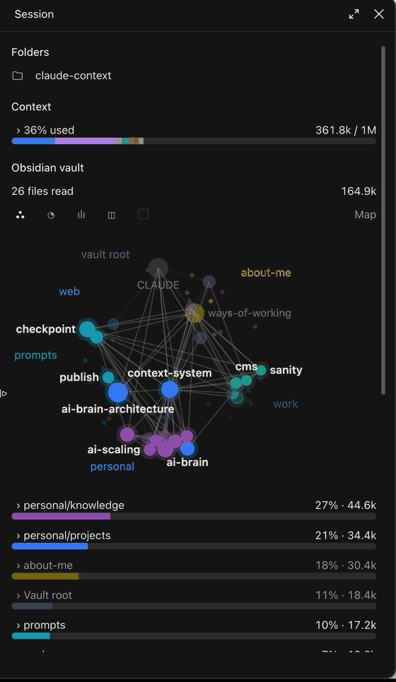

# Context rail

A pane beside the chat in Claude Code and the Claude desktop app that shows what the session holds, which of your Obsidian notes it has read, and what it costs.


I keep an Obsidian vault of notes about myself and my work, and Claude's answers are far better when it reads them. But I could never tell whether a session had actually read the vault, which notes it read, or how much of the context they took. The rail shows that as it happens: every note each response reads, how they link, and their share of the context.

<p>
  
  
</p>

- **Folders:** the session's folders. Hover for the path, click to open it in Finder. If no Obsidian vault is in the session, it says so here in orange.
- **Context:** how full the context window is, as a bar coloured by what fills it, with your vault's notes as their own purple part. Open it to see each part.
- **Obsidian vault:** which notes the session has read, grouped by folder, with each folder's share of the tokens read. What the latest turn used is drawn bright, the rest dim.
- **Plan limits:** the 5-hour and weekly limits as bars, with when each resets.
- **Cost:** the session total, each turn's cost and time, and the last turn's tokens.

Above the vault list are five charts, picked with the icon buttons over them. Hover any item in a chart for its name.

- **Map:** the notes read, each in its top folder's slice of a circle at a spot fixed by its path, so the map keeps its shape. Size is tokens loaded, lines are the `[[links]]` between them, and faint dots are notes linked to them that were not loaded. Click a file in the list to ring it on the map.
- **Share:** a donut of the tokens loaded, by folder, each folder split into its notes. Hover a segment for the note and its share.
- **Timeline:** each turn's notes, stacked by size. A dashed outline marks a note read again.
- **Treemap:** the notes as rectangles sized by tokens.
- **Gaps:** the notes most linked to what was loaded but not loaded themselves.

Under each reply it adds a line with that turn's cost and the vault notes it used. `/context-rail` opens the pane if it was closed; a bar above the prompt offers the same when you close it.

## Your vault

The mod finds your vault by itself: the first folder the session uses that is inside a vault (a folder holding `.obsidian`). To name it instead, set `vaultPath` to its folder, for example `~/Documents/Brain`.

Colours come from your vault's own graph colour groups in Obsidian (Settings, Graph view, Groups). A note no group matches takes a colour picked from its top folder. Notes in hidden folders, folders starting with `_`, and folders Obsidian is set to exclude are left out.

If your vault is set up differently, ask Claude to adapt the mod to it: `CLAUDE.md` in this folder tells it how.

## Install

Clone the repository, add the folder as a marketplace, and install the mod for every session. Installed this way, the mod runs straight from the folder, so a `git pull` and `/reload-plugins` in a chat is all an update needs.

```bash
git clone https://github.com/Riu-F/context-rail.git ~/.claude/mods/context-rail
claude plugin marketplace add ~/.claude/mods/context-rail
claude plugin install context-rail@context-rail --scope user
```

If `claude` is not on your PATH, use the copy inside the desktop app:
`"$HOME/Library/Application Support/Claude/claude-code/<version>/<build>/claude.app/Contents/MacOS/claude"`.

Start a new chat and the pane opens by itself.

## Develop

Edit the files, then run `/reload-plugins` in a chat. Check a change with:

```bash
claude plugin validate .
claude plugin test .
```
